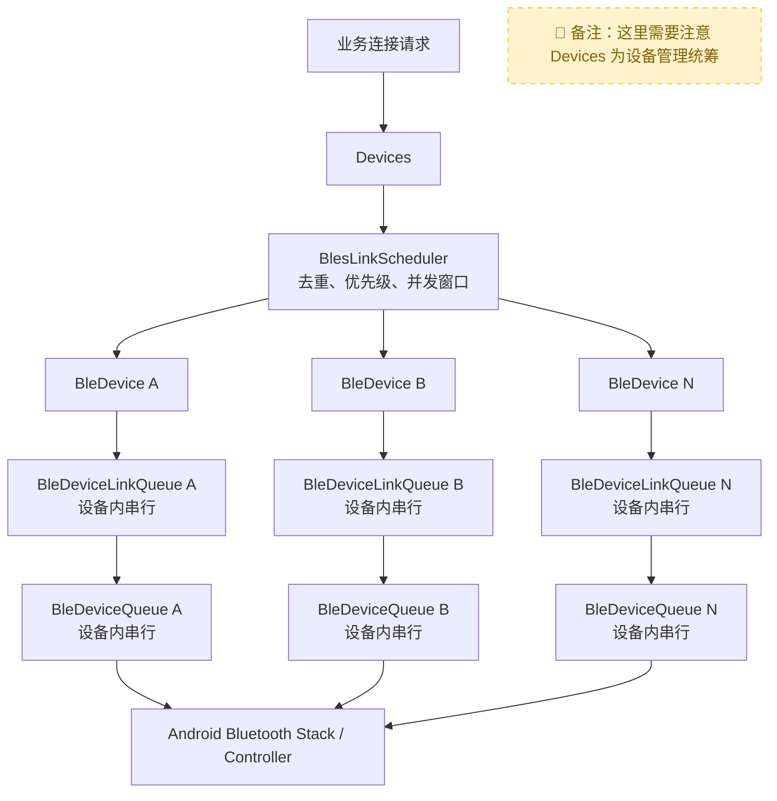
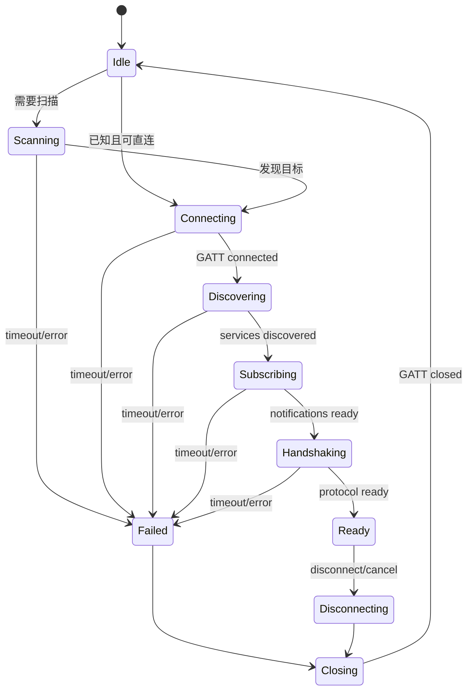

# Android BLE 多设备并发连接 拆解

## 摘要

> **裁定：Android 支持同时维护多个 BLE GATT 连接，因此多设备并发连接在能力层面可行；但 Android 与 Bluetooth 官方规范均未承诺扫描、连接、服务发现和业务初始化可在 3 秒内完成。**
>
> 因此，“3 秒”应定义为指定设备数、手机型号、外设状态和射频环境下的性能 **SLO（服务等级目标）**，不能定义为跨机型、跨设备的硬性 **SLA（服务等级协议）**。多线程重构可以消除 SDK 内部队列互相阻塞，但不能突破系统蓝牙栈、控制器、广播周期、射频环境或外设响应速度的限制。

建议以“单设备内 GATT 操作串行、多设备会话并行、全局连接窗口限流”为重构原则，并通过 P50/P95/P99、3 秒达标率和错误码分布验证目标。

## 1. 问题定义

### 1.1 “3 秒”的起止点

若不先统一口径，“连接耗时”将无法比较。建议记录以下时间点：

| 时间点 | 含义 |
| --- | --- |
| `T0` | SDK 收到连接请求 |
| `Tscan` | 首次扫描到目标设备；已知且可直连时可为空 |
| `Tconnected` | 收到 `onConnectionStateChange(..., STATE_CONNECTED)` |
| `Tservices` | 收到成功的 `onServicesDiscovered` |
| `Tnotify` | 必要通知/指示的 CCCD 写入成功 |
| `Tready` | 设备协议握手、鉴权或初始化完成，可以收发业务数据 |

本文默认以 **`Tready - T0 <= 3 秒`** 作为“3 秒业务就绪”的完整目标。如果产品只要求 `Tconnected - T0 <= 3 秒`，必须明确标注为“GATT 已连接”，不能称为“设备已可用”。

### 1.2 “多并发”的口径

“多并发”必须附带设备数 `N`。Android 官方公开 API 支持查询多个 GATT 连接，但未对所有 Android 设备承诺统一的最大并发数量。因此不采用“Android 固定最多连接 7/15/20 台”等未经官方保证的数字。

建议首轮按 `N = 1 / 2 / 3 / 5` 分档测试，再根据目标机型实测结果确定生产配置；连接窗口应可配置，不应无限制同时调用 `connectGatt()`。

### 1.3 测试场景

必须区分以下场景，不能将其中某一种结果外推为全部场景：

- 已知地址直连 / 先扫描再连接；
- 外设已唤醒并持续可连接广播 / 休眠或未广播；
- 冷连接 / 已连接后的业务恢复 / 断线重连；
- 已配对 / 首次配对或需要用户确认；
- 前台 / 后台；
- 强、中、弱信号及不同干扰环境。

### 2. 举证：为什么“多设备并发连接”可行

#### 2.1 Android API 具备多 GATT 设备管理能力

Android `BluetoothManager.getConnectedDevices(BluetoothProfile.GATT)` 返回 GATT Profile 下的已连接设备列表，`getDevicesMatchingConnectionStates(...)` 也返回多个符合状态的设备。这证明 Android API 模型允许同时管理多个 GATT 设备，而非只允许单设备连接。

官方依据：[Android `BluetoothManager`](https://developer.android.com/reference/android/bluetooth/BluetoothManager#getConnectedDevices(int))。

需要限定的是：该 API 证明的是“支持多个”，**不代表官方承诺任意并发数量或特定连接时延**。

#### 2.2 每个设备可拥有独立 GATT 会话和异步回调

`BluetoothDevice.connectGatt()` 为目标设备创建 `BluetoothGatt` 客户端，连接结果及后续 GATT 操作由 `BluetoothGattCallback` 异步返回。API 26 的重载允许指定 `Handler`，新 API 还支持显式 `Executor`，因此应用能够隔离不同设备的回调处理与业务状态。

官方依据：

- [连接到 GATT 服务端](https://developer.android.com/develop/connectivity/bluetooth/ble/connect-gatt-server)
- [`BluetoothDevice.connectGatt`](https://developer.android.com/reference/android/bluetooth/BluetoothDevice#connectGatt(android.content.Context,boolean,android.bluetooth.BluetoothGattCallback,int))

线程隔离能减少应用层相互等待，但这里的“回调并行”不等于蓝牙控制器能让全部无线过程同时完成。

#### 2.3 项目已有优化证明应用层阻塞值得治理

项目 SDK 历史版本已进行以下优化：

- `0.9.394`：将 GATT 30 秒超时提前至 8 秒处理；
- `0.9.394`：单设备 `IoQueue` 独享线程，多设备线程互不 `delay`；
- `0.9.300`：BLE 重连使用独立线程处理，并规范连接/断开调用线程。

这些记录说明项目过去确实存在多设备共享队列导致互相阻塞的风险，按设备隔离队列有实际价值。它们只能证明优化方向合理，不能直接证明“3 秒必达”。项目依据：[Android SDK 历史版本说明](../../yasee_android/download.md)。

## 3. 质证：为什么不能承诺所有设备 3 秒内就绪

### 3.1 连接流程是多阶段异步链路

`connectGatt()` 的连接结果通过回调异步返回；连接后仍需调用异步的 `discoverServices()`，随后通常还要启用通知、写入 CCCD，并执行厂商协议握手。`onConnectionStateChange(STATE_CONNECTED)` 只代表 GATT 连接状态变化，不代表服务发现和业务初始化已经完成。

官方依据：

- [`BluetoothGatt.discoverServices()`](https://developer.android.com/reference/android/bluetooth/BluetoothGatt#discoverServices())：明确说明服务发现为异步操作，完成后触发 `onServicesDiscovered`；
- [`BluetoothGattCallback`](https://developer.android.com/reference/android/bluetooth/BluetoothGattCallback#onConnectionStateChange(android.bluetooth.BluetoothGatt,int,int))：连接状态、服务发现、描述符写入均为不同回调。

**质证结论：**只测到 `Tconnected` 会低估真实可用时间，3 秒验收必须明确是否包含 `Tservices`、`Tnotify` 和 `Tready`。

### 3.2 扫描发现时间不可由 App 单方面控制

BLE 扫描结果通过 `ScanCallback` 异步返回，能否及时发现设备取决于外设是否广播、广播周期、手机扫描调度、权限、位置/附近设备设置、信号与干扰。Android 官方建议找到目标后立即停止扫描、不要循环扫描并为扫描设置时限；官方示例中的 10 秒只是示例超时，并非系统规定的扫描耗时。

官方依据：

- [Android：查找 BLE 设备](https://developer.android.com/develop/connectivity/bluetooth/ble/find-ble-devices)
- [AOSP：Bluetooth Low Energy](https://source.android.com/docs/core/connect/bluetooth/ble)

**质证结论：**若 `T0` 从“开始扫描”计算，外设休眠、广播间隔较长或弱信号时不能保证 3 秒；已知地址、目标正在可连接广播时成功概率更高。

### 3.3 系统栈和控制器是共享资源，存在拥塞与超时

Android 定义了 `GATT_CONNECTION_CONGESTED`，明确表示远端设备连接可能拥塞；也定义了 `GATT_CONNECTION_TIMEOUT`，说明设备超出范围或未作为可连接设备广播时可能超时。应用创建更多线程不会增加手机蓝牙控制器、射频时隙或系统 GATT 栈容量。

官方依据：[`BluetoothGatt` 状态码](https://developer.android.com/reference/android/bluetooth/BluetoothGatt)。

**质证结论：**多线程只能处理 CPU 侧工作，不能把系统与无线链路变成无限并行。过度同时发起连接反而可能放大拥塞，应通过连接窗口限流。

### 3.4 协议参数存在较大合法范围

Android `onConnectionUpdated` 文档给出的连接间隔合法范围为 7.5 ms～4000 ms，监督超时范围为 0.1 s～32 s。`requestConnectionPriority(HIGH)` 只是请求低延迟连接参数，官方建议仅在快速传输大量数据时使用，并在完成后恢复 `BALANCED`；`setPreferredPhy()` 也只是建议，实际是否切换取决于双方能力，控制器可覆盖设置。

官方依据：

- [`BluetoothGattCallback.onConnectionUpdated`](https://developer.android.com/reference/android/bluetooth/BluetoothGattCallback#onConnectionUpdated(android.bluetooth.BluetoothGatt,int,int,int,int))
- [`BluetoothGatt.requestConnectionPriority`](https://developer.android.com/reference/android/bluetooth/BluetoothGatt#requestConnectionPriority(int))
- [`BluetoothGatt.setPreferredPhy`](https://developer.android.com/reference/android/bluetooth/BluetoothGatt#setPreferredPhy(int,int,int))

**质证结论：**官方 API 没有给出 3 秒完成上界，“高优先级”与“首选 PHY”也不能作为 3 秒保证手段。

### 3.5 Android 硬件与厂商实现存在差异

AOSP 明确指出 BLE 使用依赖设备芯片支持，扫描过滤等能力也与控制器/固件实现相关。不同 SoC、Android 版本、厂商蓝牙栈和功耗策略会造成连接数量、调度及后台表现差异；外设自身还可能限制可同时连接的 central 数量。

官方依据：[AOSP：Bluetooth Low Energy](https://source.android.com/docs/core/connect/bluetooth/ble)。Bluetooth 技术与互操作性的规范入口见 [Bluetooth SIG Core Specification 6.1](https://www.bluetooth.com/specifications/specs/core-specification-6-1/)，该入口同样未给出适用于所有 Android 与外设组合的“3 秒业务就绪”承诺。

**质证结论：**单一手机、单一外设的一次成功不能证明跨机型 SLA；必须使用机型和外设矩阵做统计验证。

### 3.6 资源未及时释放会降低后续连接稳定性

Android 官方要求不再使用 GATT client 时尽早调用 `close()`。仅调用 `disconnect()`、未处理超时/取消路径或保留失效 `BluetoothGatt`，可能造成资源长期占用。

官方依据：

- [Android：关闭 GATT 连接](https://developer.android.com/develop/connectivity/bluetooth/ble/connect-gatt-server#close-gatt)
- [`BluetoothGatt.close()`](https://developer.android.com/reference/android/bluetooth/BluetoothGatt#close())

**质证结论：**3 秒优化不能只关注“发起连接”，还必须确保失败、取消和断开路径最终释放资源。

## 4. 裁定与适用边界

| 场景 | 3 秒目标判断 | 说明 |
| --- | --- | --- |
| 已知设备地址、外设已唤醒且正在可连接广播、近距离、少量设备 | **可作为高概率 SLO** | 仍需目标机型实测，不能写成系统保证 |
| 已扫描到目标后开始计时 | **比全流程更可控** | 必须注明不包含扫描耗时 |
| 从启动扫描到业务就绪 | **可以优化，不能硬保证** | 发现时间受外设广播与环境影响 |
| 外设休眠、未广播、超距或弱信号 | **不可承诺** | App 无法单方面建立连接 |
| 首次配对或需要用户操作 | **不可承诺** | 存在系统交互及不确定等待 |
| 大量设备同时连接 | **需分档实测** | 官方没有统一最大并发数或时延保证 |
| 后台、锁屏或厂商严格省电模式 | **需单独验收** | 调度和进程存活受系统策略影响 |

最终产品口径建议为：

> 在约定手机与外设矩阵、设备已唤醒且可连接、指定信号范围和并发数 `N` 下，以 `Tready - T0` 统计 3 秒达标率；目标值以压测基线评审后确定。异常场景进入超时、重试或用户引导，不承诺跨设备 100% 达标。

## 5. 重构方案

### 5.1 架构原则



- **多设备之间并行：**每个设备持有独立 `BleDeviceQueue`、`BluetoothGatt` 和操作队列，避免设备 A 的延迟阻塞设备 B。
- **单设备内部串行：**服务发现、MTU、通知描述符、read/write 等按回调逐项推进，不应对同一个 GATT 无序多线程调用。
- **全局连接限流：**`BlesLinkScheduler` 只允许可配置数量的连接尝试同时在途；剩余请求按优先级排队。
- **状态唯一来源：**回调只投递标准化事件，由 BlesLinkScheduler 决定下一步，避免回调线程直接修改多处共享状态。

### 5.2 组件职责

#### `Devices`

- 使用稳定设备标识维护 `sessionMap`；
- 对重复连接请求去重，并复用同一 in-flight 结果；
- 对外输出连接阶段、失败原因和阶段耗时；
- 统一处理蓝牙关闭、权限丢失及 SDK 生命周期。

#### `BlesLinkScheduler`

- 管理可配置的连接窗口，不无限并发调用 `connectGatt()`；
- 支持业务优先级、公平调度和取消排队请求；
- 根据机型和压测结果调整窗口，不在代码中假定 Android 固定并发上限；
- 扫描时使用 `ScanFilter` 尽快筛选目标，全部目标发现后停止扫描。

#### `BleDevice`

每个设备采用独立状态机：



要求：

- 每次尝试带 `attemptId`，忽略旧连接的迟到回调；
- 连接式 BLE 设备在适用 API 上显式使用 `TRANSPORT_LE`，避免双模设备的 transport 歧义；
- 对扫描、连接、服务发现、订阅、握手分别设置阶段超时；
- 任意失败、取消和断开路径最终执行 `disconnect()`（适用时）与 `close()`；
- 重试采用有界指数退避并加入随机抖动，避免多设备同步重试形成尖峰；
- 已 `Ready` 的设备不要因新的批量连接请求被重复初始化。

#### `BleDeviceQueue`

- 同一设备同一时间只允许一个需要回调确认的 GATT 操作在途；
- 收到对应回调后再推进下一项，并校验操作类型、UUID 与 `attemptId`；
- 每项操作独立超时，不使用全局 sleep 阻塞其他设备；
- Android 33+ 优先使用带 `byte[] value` 的新读写 API，避免可变 characteristic value 带来的竞态；
- `requestConnectionPriority(HIGH)` 仅在确有快速初始化/传输需要且设备支持时短时请求，完成后恢复 `BALANCED`。

### 5.3 线程模型

建议使用“**状态串行化，而不是线程数量最大化**”：

- 每个 Gatt 的状态转换在固定串行执行器 IoQueue 中完成；
- 不同 Gatt 可并发运行；肥胖等级
- 
- GATT 回调快速封装为不可变事件后投递，不在回调中执行算法、JSON 解析或磁盘 I/O；
- CPU 密集解析进入共享有界计算线程池，日志/文件操作进入 I/O 池；
- 主线程只承担系统 API 要求或 UI 事件分发，不执行阻塞等待；
- 线程池、队列和重试均设置上限，避免设备数增大时线性创建无限线程。

## 6. 3 秒性能预算

预算用于定位瓶颈，不是官方时限。建议首先分别统计“已扫描到目标后”和“包含扫描”的两套指标。

| 阶段 | 记录指标 | 优化方向 |
| --- | --- | --- |
| 扫描发现 | `Tscan - T0` | 已知设备按产品能力选择直连；使用过滤器；目标齐全后立即停扫 |
| GATT 连接 | `Tconnected - Tscan/T0` | 去重、适度连接窗口、外设预唤醒、显式 LE transport |
| 服务发现 | `Tservices - Tconnected` | 避免重复发现；校验缓存/Service Changed 行为 |
| 通知订阅 | `Tnotify - Tservices` | 单设备队列串行；只订阅必要特征；逐项确认 CCCD 写入 |
| 业务握手 | `Tready - Tnotify` | 减少非必要指令与固定 delay；使用回调/协议事件推进 |
| 总耗时 | `Tready - T0` | 按设备数、机型、场景统计 P50/P95/P99 与达标率 |

禁止为了“看起来小于 3 秒”而把 `STATE_CONNECTED` 提前映射为业务 `Ready`。如阶段超过预算，应上报具体阶段和原因，而不是统一记为“连接失败”。

## 7. 可观测性与错误归因

每次连接至少记录：

- 匿名化设备标识、设备型号/协议、手机型号、Android 版本、App/SDK 版本；
- 是否需要扫描、前后台、是否已配对、连接窗口大小、尝试序号；
- `T0/Tscan/Tconnected/Tservices/Tnotify/Tready`；
- 扫描 RSSI、GATT `status/newState`、失败阶段、超时类型；
- 主动取消、蓝牙关闭、权限缺失、外设未广播、拥塞、系统超时等标准化原因；
- 每轮开始和结束时的活跃 session/GATT 数，便于发现资源泄漏。

日志中的 MAC、用户信息等应脱敏；性能统计按阶段聚合，不能只统计成功样本。

## 8. 验证与验收

### 8.1 测试矩阵

| 维度 | 建议覆盖 |
| --- | --- |
| 并发设备数 | `1 / 2 / 3 / 5`，生产上限由结果决定 |
| 连接类型 | 冷连接、断线重连、已连接恢复 |
| 发现方式 | 已知地址/设备对象、从扫描开始 |
| 外设状态 | 已唤醒可连接、休眠后唤醒、不可连接 |
| App 状态 | 前台、后台、锁屏恢复 |
| 信号 | 强/中/弱 RSSI；有/无 2.4 GHz 干扰 |
| 配对 | 已配对、未配对、配对信息失效 |
| 手机 | Pixel、Samsung、小米、OPPO、vivo 等目标主流机型及最低 Android 版本 |
| 规模 | 每个核心组合至少 100 轮；稳定性场景建议 1000 轮或持续压测 |

### 8.2 指标

- `Tconnected - T0` 与 `Tready - T0` 的 P50/P95/P99；
- 单设备与“本批全部设备”3 秒达标率；
- 首次成功率、最终成功率、平均重试次数；
- 各阶段超时率及 GATT 状态码分布；
- 并发数增加后的耗时退化曲线；
- 断开后资源回收成功率、长稳内存/线程/GATT 数量；
- 对其他已连接设备的数据吞吐、丢包和测量流程影响。

### 8.3 验收门槛

当前没有目标机型与外设的基线数据，因此本文不虚构具体达标率。建议流程：

1. 先按上述埋点采集现状基线；
2. 产品、客户端、SDK 与测试共同确定核心场景和目标并发数 `N`；
3. 根据基线确定 P95、P99、3 秒达标率和最终成功率门槛；
4. 将非受控场景单列为降级指标，不纳入“3 秒硬保证”；
5. 重构前后使用同一矩阵、同一外设固件和同一环境做对照测试。

## 9. 风险与降级策略

| 风险 | 降级或处理 |
| --- | --- |
| 3 秒内未就绪 | UI 展示当前阶段，后台继续到业务超时；不要立即判定永久失败 |
| 外设未广播/休眠 | 提示唤醒、靠近设备或检查占用情况 |
| 并发拥塞 | 动态缩小连接窗口，将剩余设备排队 |
| 弱信号或反复断开 | 有界退避重试；达到阈值后提示用户干预 |
| 首次配对 | 单独进入配对流程，不纳入无交互 3 秒 SLO |
| 后台限制 | 前台服务等方案需结合具体业务和 Android 政策单独设计 |
| 外设仅允许单 central | 明确提示设备被占用；不能通过 App 多线程绕过 |
| GATT 资源异常 | 取消当前 session，完整 `close()` 后再按退避策略重建 |

## 10. 结论

1. **能力可行：**Android GATT API 支持多个已连接设备，每个设备可建立独立会话，项目已有按设备隔离队列的优化基础。
2. **时间不可硬保证：**扫描、连接、服务发现、通知订阅和业务握手均为异步阶段；系统栈、控制器、射频环境、Android 厂商实现及外设状态都不由应用线程完全控制。
3. **重构有价值：**每设备独立状态机与操作队列可以消除 SDK 自身阻塞；全局连接协调器可避免过度并发造成拥塞。
4. **3 秒应作为受控 SLO：**明确 `N`、起止点、目标机型、外设状态与环境，通过 P50/P95/P99、达标率和错误分布验收，不能宣传为全 Android 平台硬 SLA。

## 11. 官方与权威资料

- Android Developers：[Connect to a GATT server](https://developer.android.com/develop/connectivity/bluetooth/ble/connect-gatt-server)
- Android Developers：[Find BLE devices](https://developer.android.com/develop/connectivity/bluetooth/ble/find-ble-devices)
- Android API：[`BluetoothDevice.connectGatt`](https://developer.android.com/reference/android/bluetooth/BluetoothDevice#connectGatt(android.content.Context,boolean,android.bluetooth.BluetoothGattCallback,int))
- Android API：[`BluetoothGatt`](https://developer.android.com/reference/android/bluetooth/BluetoothGatt)
- Android API：[`BluetoothGattCallback`](https://developer.android.com/reference/android/bluetooth/BluetoothGattCallback)
- Android API：[`BluetoothManager`](https://developer.android.com/reference/android/bluetooth/BluetoothManager)
- AOSP：[Bluetooth Low Energy](https://source.android.com/docs/core/connect/bluetooth/ble)
- Bluetooth SIG：[Core Specification 6.1](https://www.bluetooth.com/specifications/specs/core-specification-6-1/)


# module:yasee 当前 BLE 架构设计梳理

当前分支：main  
模块：yasee  
重点范围：BLE 扫描、设备管理、连接、GATT 初始化、数据收发、平台适配、性能埋点。

---


# 2. SDK 顶层入口：Yasee

文件：

```text
yasee/src/main/java/com/yasee/yasee/Yasee.java
```

职责：

```text
1. 保存 Android Context
2. 保存 BLE 配置 BleConfig
3. 保存串口配置 SerialConfig
4. 保存日志配置 LogConfig
5. 暴露 SDK 顶层 API
6. 初始化 BLE 和各个平台单例
```

主要对外 API：

```java
Yasee.getSingle().setContext(context);
Yasee.getSingle().scan();
Yasee.getSingle().stop();
Yasee.getSingle().enableBle();
Yasee.getSingle().setCurrentUser(user);
```

初始化时会执行：

```java
Ble.single();
PlatformTmd.single();
PlatformWl.single();
PlatformHlw.single();
PlatformYc.single();
```

说明：

```text
Yasee 是 SDK 的顶层控制单元。
业务层通常不直接操作 BleDevice，而是通过 Yasee、Devices、Notify 等入口和回调完成交互。
```

---

# 3. BLE 配置：BleConfig

文件：

```text
yasee/src/main/java/com/yasee/yasee/core/configs/BleConfig.java
```

职责：

```text
1. 配置扫描持续时间
2. 配置 BLE 设备名过滤正则
3. 配置是否自动重连
4. 配置是否启用连接指数退避
5. 预留是否使用 Service UUID 过滤
```

核心字段：

```java
private final Integer scanTimer;
private final boolean reconnect;
private final boolean backoff;
private final boolean filterWithServices;
private final Pattern pattern;
```

默认配置：

```java
public BleConfig(Integer scanTimer) {
    this(scanTimer, DEFAULT_PATTERN, true, true, false);
}
```

当前默认含义：

```text
scanTimer：由调用方传入
pattern：使用 DEFAULT_PATTERN
reconnect：true
backoff：true
filterWithServices：false
```

其中 `pattern` 用于扫描时按设备名过滤支持的 BLE 设备。

---

# 4. 蓝牙扫描与蓝牙状态管理：Ble

文件：

```text
yasee/src/main/java/com/yasee/yasee/protocols/ble/Ble.java
```

职责：

```text
1. 管理 BluetoothManager
2. 管理系统蓝牙开关状态
3. 注册 BluetoothAdapter.ACTION_STATE_CHANGED 广播
4. 启动 BLE 扫描
5. 停止 BLE 扫描
6. 过滤扫描结果
7. 将符合条件的 ScanResult 交给 Devices
8. 记录扫描发现性能埋点
```

## 4.1 单例入口

```java
public static Ble single() {
    return instance;
}
```

## 4.2 蓝牙状态

字段：

```java
private boolean _bleState = false;
```

方法：

```java
public void setBleState(boolean open)
public boolean getBleState()
```

蓝牙状态由 `BleStateReceiver` 根据系统广播更新。

## 4.3 扫描状态

字段：

```java
private AtomicBoolean _ab = new AtomicBoolean(false);
```

当前扫描开始时判断：

```java
if (_ab.get()) {
    Logs.print("正在扫描中..");
    return;
}
```

扫描停止时：

```java
_ab.set(false);
```

注意：

```text
当前 _scan() 中没有看到 _ab.set(true) 或 compareAndSet(false, true)。
这意味着扫描状态位当前可能无法正确表示“正在扫描中”。
```

## 4.4 扫描参数

当前扫描使用：

```java
ScanSettings scanSettings = new ScanSettings.Builder()
        .setScanMode(ScanSettings.SCAN_MODE_LOW_LATENCY)
        .setReportDelay(0)
        .setNumOfMatches(ScanSettings.MATCH_NUM_ONE_ADVERTISEMENT)
        .build();
```

含义：

```text
SCAN_MODE_LOW_LATENCY：高频扫描，发现速度快，但耗电更高。
setReportDelay(0)：实时回调扫描结果。
MATCH_NUM_ONE_ADVERTISEMENT：匹配到一次广告即可回调。
```

## 4.5 扫描过滤

当前扫描没有使用 `ScanFilter`：

```java
startScan(null, scanSettings, _scanResult);
```

过滤逻辑在 App 层通过设备名正则完成：

```java
String _name = result.getScanRecord().getDeviceName();

if (!Yasee.getSingle().bleConfig.getPattern().matcher(_name).matches()) {
    Logs.print("搜索到设备(未受支持): " + _name);
    return;
}
```

## 4.6 扫描结果处理

符合条件后：

```java
PerformanceTool.recordBleScanFound(result.getDevice().getAddress(), _name);
Devices.getSingle().addSearchDevice(result);
```

流程：

```text
BLE 广播被扫描到
↓
读取 ScanRecord.deviceName
↓
通过 BleConfig.pattern 过滤
↓
记录 ble_scan_found 性能事件
↓
交给 Devices.addSearchDevice()
```

---

# 5. 蓝牙状态广播：BleStateReceiver

文件：

```text
yasee/src/main/java/com/yasee/yasee/core/receivers/BleStateReceiver.java
```

监听广播：

```java
BluetoothAdapter.ACTION_STATE_CHANGED
```

核心行为：

```java
case BluetoothAdapter.STATE_ON:
    Ble.single().setBleState(true);
    Devices.getSingle().allAction(true);
    break;

case BluetoothAdapter.STATE_TURNING_OFF:
    Ble.single().setBleState(false);
    Devices.getSingle().allAction(false);
    break;
```

作用：

```text
蓝牙打开：
    更新 BLE 状态
    自动连接所有绑定设备

蓝牙正在关闭：
    更新 BLE 状态
    断开所有绑定设备
```

最后通过 Notify 上报蓝牙状态：

```java
Notify.getSingle().onNext(
    new NotifyResp<BleState>(
        NotifyType.bleState,
        state == BluetoothAdapter.STATE_ON ? BleState.on : BleState.off
    )
);
```

---

# 6. 设备仓库与绑定管理：Devices

文件：

```text
yasee/src/main/java/com/yasee/yasee/Devices.java
```

职责：

```text
1. 保存所有 BLE 设备
2. 保存已绑定设备 MAC 集合
3. 保存 Wi-Fi 设备列表
4. 扫描设备去重
5. 搜索设备转绑定设备
6. 初始化绑定设备
7. 批量连接/断开绑定设备
8. 通过 Notify 上报搜索设备和绑定设备列表
```

## 6.1 数据结构

```java
private final Map<String, BleDevice> bleDeviceMap = new LinkedHashMap<>();
private final Set<String> bindMacs = new LinkedHashSet<>();
private List<WifiDevice> wifiDevices = new ArrayList<>();
```

设计含义：

```text
bleDeviceMap：
    保存所有 BLE 设备，包括搜索到的设备和已绑定设备。
    key 为 MAC 地址。

bindMacs：
    保存已绑定设备的 MAC 地址。
    用于区分 searchDevices 和 bindDevices。

wifiDevices：
    保存 Wi-Fi 协议设备。
```

## 6.2 初始化绑定设备

```java
public void initDevices(List<BleDevice> devices)
```

流程：

```text
校验 SDK verifyOk
↓
清空 bleDeviceMap
↓
清空 bindMacs
↓
写入传入的绑定设备
↓
allAction(true) 自动连接所有绑定设备
↓
通知绑定设备列表
↓
通知搜索设备列表
```

## 6.3 新增搜索设备

```java
public void addSearchDevice(ScanResult result)
```

流程：

```text
从 ScanResult 获取 BluetoothDevice
↓
获取 MAC 并转大写
↓
如果 bleDeviceMap 已存在该 MAC，直接忽略
↓
否则创建 BleDevice
↓
放入 bleDeviceMap
↓
通知搜索设备列表
```

代码：

```java
BluetoothDevice device = result.getDevice();
String mac = StringTool.up(device.getAddress());

if (bleDeviceMap.containsKey(mac)) return;

bleDeviceMap.put(mac, new BleDevice(device, new AdvertisementData(result)));
notifySearchDevices();
```

## 6.4 搜索设备转绑定设备

```java
public void addedBindDevice(BleDevice device)
```

流程：

```text
获取设备 MAC
↓
放入 bleDeviceMap
↓
加入 bindMacs
↓
记录 added_bind_device 性能事件
↓
通知搜索设备列表
↓
通知绑定设备列表
```

关键代码：

```java
bleDeviceMap.put(mac, device);
bindMacs.add(mac);
PerformanceTool.recordBleAddedBindDevice(mac, device.getModel());
```

## 6.5 批量连接/断开

```java
public void allAction(boolean open)
```

当前逻辑：

```java
for (String mac : bindMacs) {
    BleDevice d = bleDeviceMap.get(mac);
    if (d == null) continue;

    if (open) {
        d.connect();
    } else {
        d.disConnect();
    }
}
```

当前架构特点：

```text
main 分支当前没有使用连接调度器。
所有绑定设备在 allAction(true) 时会逐个直接调用 BleDevice.connect()。
```

这意味着：

```text
如果绑定设备较多，多个设备可能几乎同时进入 connectGatt 流程。
连接节流主要依赖 BleDevice 内部 linkQueue 和 ExponentialBackoff，而不是全局调度器。
```

---

# 7. 单个 BLE 设备：BleDevice

文件：

```text
yasee/src/main/java/com/yasee/yasee/protocols/ble/BleDevice.java
```

职责：

```text
1. 封装 BluetoothDevice
2. 保存广播 AdvertisementData
3. 管理 BluetoothGatt
4. 发起连接 connectGatt
5. 处理 BluetoothGattCallback
6. 服务发现
7. MTU 请求
8. notify/indicate 订阅
9. 写特征选择
10. 数据发送
11. 数据读取
12. GATT cache 清理
13. 自动重连
14. 性能埋点
```

---

## 7.1 构造方式

### 通过扫描结果构造

```java
public BleDevice(BluetoothDevice device, AdvertisementData avd)
```

用于扫描设备：

```text
ScanResult
↓
BluetoothDevice
↓
AdvertisementData
↓
BleDevice
```

### 通过 MAC 构造

```java
public BleDevice(String mac, AdvertisementData avd)
```

用于反序列化、初始化绑定设备等场景。

逻辑：

```text
校验 MAC
↓
保存 AdvertisementData
↓
先尝试从 Devices 中查找已有设备
↓
如果已有 BluetoothDevice，则复用
↓
否则通过 BluetoothAdapter 创建远程设备对象
```

Android 13+ 使用：

```java
getRemoteLeDevice(mac, addressType)
```

低版本使用：

```java
BluetoothAdapter.getDefaultAdapter().getRemoteDevice(mac)
```

---

## 7.2 设备状态

继承自：

```text
core/abstracts/Device.java
```

状态定义：

```text
0：未连接
1：已连接
2：可读写 / ready
```

`BleDevice.setState()` 做了扩展：

```java
super.setState(newState);

Notify.getSingle().onNext(
    new NotifyResp(
        NotifyType.deviceLink,
        new NotifyResp.BleLink(
            BleDevice.this,
            newState == 2 ? DeviceProcess.rwIsOk :
            newState == 1 ? DeviceProcess.linked :
            DeviceProcess.unlink
        )
    )
);

Devices.getSingle().notifyBindDevices();
this.debounce.clear();
```

状态变化会触发：

```text
1. 更新时间
2. 保存 lastState
3. Notify deviceLink
4. Notify bindDevices
5. 清除发送响应 debounce
```

---

# 8. 连接流程

入口：

```java
public void connect()
```

当前连接流程：

```text
检查蓝牙是否开启
↓
向 linkQueue 添加连接任务
↓
执行指数退避 delay
↓
记录 connect_start 性能事件
↓
调用 connectGatt()
↓
等待 BluetoothGattCallback.onConnectionStateChange()
```

关键代码：

```java
long delay = exponentialBackoff.nextDelayMs();
Thread.sleep(delay);

PerformanceTool.recordBleConnectStart(getMac(), getModel());

_gatt = device.connectGatt(
    Yasee.getSingle().getContext(),
    false,
    _gattCallBack,
    BluetoothDevice.TRANSPORT_LE
);
```

## 8.1 连接队列 linkQueue

`linkQueue` 来自 Device 基类：

```java
protected final transient BleIoQueue linkQueue = new BleIoQueue();
```

当前用途：

```text
1. 包装 connectGatt 连接任务
2. 保证单设备连接任务顺序
3. 给连接任务设置 timeout
4. timeout 后清理 GATT 并重连
```

当前连接任务 timeout：

```java
protected long timeoutMillis() {
    return 35_000L;
}
```

timeout 逻辑：

```java
linkQueue.clear();
PerformanceTool.recordBleReadyTimeout(getMac(), getModel());
refreshDeviceCache();
connect();
```

说明：

```text
当前 main 分支中，连接 timeout 是 35 秒。
timeout 后会清理 GATT 并再次调用 connect()。
```

---

## 8.2 指数退避

字段：

```java
private ExponentialBackoff exponentialBackoff = new ExponentialBackoff(
    Yasee.getSingle().bleConfig.getBackOff() ? 300 : 0,
    Yasee.getSingle().bleConfig.getBackOff() ? 15000 : 1,
    2,
    true
);
```

含义：

```text
如果 BleConfig.backoff = true：
    初始延迟 300ms
    最大延迟 15000ms
    倍增系数 2
    启用 jitter

如果 backoff = false：
    初始延迟 0
    最大延迟 1
```

连接成功后会重置退避：

```java
exponentialBackoff.reset();
```

---

## 8.3 连接成功

回调：

```java
onConnectionStateChange()
```

成功条件：

```java
newState == BluetoothProfile.STATE_CONNECTED
&& status == BluetoothGatt.GATT_SUCCESS
```

成功后执行：

```text
记录 connect_success 性能事件
↓
重置指数退避
↓
linkQueue.onComplete()
↓
linkQueue.clear()
↓
setState(1)
↓
调用平台 BleInterface.onConnectionStateChange()
↓
如果平台没有全面接管 GATT，则进入 discoverServices
```

关键代码：

```java
PerformanceTool.recordBleConnectSuccess(getMac(), getModel());
exponentialBackoff.reset();
linkQueue.onComplete();
linkQueue.clear();
setState((short) 1);
```

然后添加服务发现任务：

```java
queue.add(new BleIoQueue.BleIoTask() {
    @Override
    protected void execute() {
        PerformanceTool.recordBleServiceDiscoverStart(getMac(), getModel());
        gatt.discoverServices();
    }
});
```

---

## 8.4 连接失败

连接状态失败分支：

```java
else {
    Logs.print("断开连接");
    PerformanceTool.recordBleConnectFail(getMac(), getModel(), status, "connection_state_changed");
    setState((short) 0);
    getPlatform().getBleInterface().onConnectionStateChange(...);

    if(!Yasee.getSingle().bleConfig.isReconnect()
        || Devices.getSingle().getBindDevice(getMac()) == null) return;

    refreshDeviceCache();
    connect();
}
```

当前重连策略：

```text
连接失败
↓
如果开启 reconnect 且设备仍在绑定列表
↓
refreshDeviceCache()
↓
直接再次 connect()
```

说明：

```text
当前 main 分支没有全局连接调度器。
重连由 BleDevice 自身递归调用 connect() 完成。
```

---

# 9. GATT 初始化流程

GATT 初始化主要在 `onServicesDiscovered()` 中完成。

## 9.1 服务发现完成

回调：

```java
onServicesDiscovered(BluetoothGatt gatt, int status)
```

首先记录：

```java
PerformanceTool.recordBleServiceDiscovered(getMac(), getModel(), status);
```

失败时：

```java
PerformanceTool.recordBleConnectFail(getMac(), getModel(), status, "service_discover_failed");
return;
```

成功后：

```text
请求 MTU
↓
获取服务列表
↓
如果平台 BleInterface.canUsed()，交给平台全面接管
↓
否则按平台 ServiceUdid 查找服务和特征
```

---

## 9.2 请求 MTU

```java
queue.add(new BleIoQueue.BleIoTask() {
    @Override
    protected void execute() {
        gatt.requestMtu(512);
    }
});
```

MTU 回调：

```java
onMtuChanged()
```

成功时：

```java
mtuSize = mtu - 3;
```

然后通知平台：

```java
getPlatform().getBleInterface().onMtuChanged(
    BleDevice.this,
    mtuSize,
    status == BluetoothGatt.GATT_SUCCESS
);
```

---

## 9.3 平台 hook 接管

如果：

```java
getPlatform().getBleInterface().canUsed()
```

则：

```java
getPlatform().getBleInterface().onServicesDiscovered(BleDevice.this, uuids);
return;
```

含义：

```text
部分平台可以通过 BleInterface 全面接管 GATT 流程。
如果 canUsed() 为 true，默认框架不继续设置 notify/write/read。
```

---

## 9.4 默认 GATT 初始化

默认流程：

```text
获取平台 ServiceUdid
↓
遍历平台定义的服务
↓
遍历服务下的特征
↓
识别 notify / indicate 特征
↓
识别 write / write_no_response 特征
↓
识别 read 特征
```

平台服务定义来自：

```java
getPlatform().getServiceUdid()
```

平台由：

```java
Platforms.getPlatform(this)
```

根据设备 model 选择。

---

# 10. notify / indicate 订阅流程

当特征支持 notify 或 indicate，且平台配置需要该特征时：

```java
boolean _indicate = (_cc.getProperties() & PROPERTY_INDICATE) > 0;
boolean _notify = (_cc.getProperties() & PROPERTY_NOTIFY) > 0;
boolean _canNI = bleCharacteristic.hasPt(indicate) || bleCharacteristic.hasPt(notify);
```

流程：

```text
1. 保存 linkChar
2. queue 添加 setCharacteristicNotification 任务
3. queue 添加 writeDescriptor 任务
```

## 10.1 setCharacteristicNotification

```java
gatt.setCharacteristicNotification(_cc, true);
```

## 10.2 写 CCCD descriptor

```java
BluetoothGattDescriptor descriptor = _cc.getDescriptor(_other.getDescr());

descriptor.setValue(
    _indicate
        ? BluetoothGattDescriptor.ENABLE_INDICATION_VALUE
        : BluetoothGattDescriptor.ENABLE_NOTIFICATION_VALUE
);

PerformanceTool.recordBleNotifySubscribeStart(getMac(), getModel());

boolean _des = gatt.writeDescriptor(descriptor);
```

## 10.3 descriptor 写入回调

```java
onDescriptorWrite()
```

记录：

```java
PerformanceTool.recordBleNotifySubscribed(getMac(), getModel(), status);
```

失败时：

```java
PerformanceTool.recordBleConnectFail(
    getMac(),
    getModel(),
    status,
    "notify_descriptor_write_failed"
);
```

---

# 11. 写特征识别与 ready 状态

当特征支持写入，并且平台配置要求写入时：

```java
boolean _w = PROPERTY_WRITE 或 PROPERTY_WRITE_NO_RESPONSE;
boolean _canW = 平台配置 write 或 write_nores;
```

如果该特征是命令特征：

```java
_write = _cc;
bleCharacteristic.linkChar = _cc;
```

Android 13+ 会设置 writeType：

```java
_write.setWriteType(
    _had
        ? BluetoothGattCharacteristic.WRITE_TYPE_DEFAULT
        : BluetoothGattCharacteristic.WRITE_TYPE_NO_RESPONSE
);
```

当前逻辑中，只要识别到可写特征，就会：

```java
PerformanceTool.recordBleReady(getMac(), getModel());
setState((short) 2);
```

含义：

```text
找到可写特征后，设备进入 ready / 可读写状态。
```

注意：

```text
当前 setState(2) 在遍历特征过程中触发。
如果设备有多个写特征，理论上可能多次触发 ready 埋点和状态设置。
```

---

# 12. GATT 数据发送

## 12.1 普通 send

入口：

```java
send(byte[] data, boolean need)
send(byte[] data, boolean need, String serviceStr, String charStr)
```

流程：

```text
如 need=true 且平台需要签名，则签名
↓
根据 mtuSize 分包
↓
设置 debounce 响应超时
↓
每个包加入 queue
↓
执行 safeWrite()
```

核心：

```java
List<byte[]> bytes = ByteTool.splitWithLength(allData, mtuSize);

for (byte[] aByte : bytes) {
    queue.add(new BleIoQueue.BleIoTask() {
        @Override
        protected void execute() {
            safeWrite(aByte, serviceStr, charStr);
        }
    });
}
```

## 12.2 根据 Check + Cmd 发送

入口：

```java
send(Check check, UUID cmd, ParmsModel parms)
```

流程：

```text
从 check.getCmds() 中找到目标 Cmd
↓
如果有 customAction，交给 customAction
↓
否则发送 cmd1.unsign
```

当前风险：

```text
当前使用 findFirst().get()。
如果没有找到 Cmd，会抛 NoSuchElementException。
后面的 cmd1 == null 判断实际上不会生效。
```

## 12.3 根据 service UUID / characteristic UUID 发送

入口：

```java
send(UUID s, UUID c, byte[] bytes, CommInterface<Boolean> result)
```

当前代码获取了：

```java
BluetoothGattCharacteristic bgc = getGatt().getService(s).getCharacteristic(c);
```

但实际写入时：

```java
safeWrite(aByte, null, null);
```

说明：

```text
当前 UUID 参数没有真正参与 safeWrite。
实际仍然写默认 _write 特征。
```

---

# 13. safeWrite 写入实现

方法：

```java
private boolean safeWrite(byte[] data, String serviceStr, String charStr)
```

流程：

```text
获取当前 GATT
↓
默认使用 _write 特征
↓
如果传入 serviceStr/charStr，则从 GATT service 中获取指定特征
↓
根据特征属性选择 writeType
↓
Android 13+ 使用新 writeCharacteristic API
↓
低版本使用旧 writeCharacteristic API
```

writeType 选择优先级：

```text
WRITE_NO_RESPONSE
↓
WRITE
↓
SIGNED_WRITE
```

当前潜在风险：

```text
if (serviceStr != null && charStr != null) {
    ch = gatt.getService(...).getCharacteristic(...);
}
if (gatt == null || ch == null) return false;
```

这里在判断 `gatt == null` 前已经使用了 `gatt.getService(...)`。

---

# 14. 数据读取

入口：

```java
read(String serviceStr, String charStr)
```

当前实现：

```java
BluetoothGattCharacteristic c = getGatt().getService(UUID.fromString(serviceStr))
        .getCharacteristic(UUID.fromString(charStr));

if (c == null) return;

getGatt().readCharacteristic(c);
```

说明：

```text
当前 read 没有进入 BleIoQueue。
它是直接调用 GATT readCharacteristic。
```

潜在影响：

```text
read 可能与 write、descriptor、MTU 等 GATT 操作并发。
```

---

# 15. 数据接收与解析

## 15.1 onCharacteristicChanged

设备主动 notify/indicate 数据时：

```java
onCharacteristicChanged(BluetoothGatt gatt, BluetoothGattCharacteristic characteristic)
```

流程：

```text
清除 debounce
↓
读取 characteristic.getValue()
↓
如果平台 BleInterface.canUsed()，交给平台 hook
↓
否则通过平台 DecodeCmd 解码
↓
通过 Notify 上报 deviceData
```

核心：

```java
DecodeCmd dd = getPlatform().getDecodeCmd(BleDevice.this, characteristic, value);

dd.getDecodeData(new DecodeInterface() {
    @Override
    public void callBack(Object obj) {
        NotifyResp.BleNotifyData _bnd =
            new NotifyResp.BleNotifyData(BleDevice.this, value, dd.getType(), obj);
        Notify.getSingle().onNext(new NotifyResp(NotifyType.deviceData, _bnd));
    }
});
```

## 15.2 onCharacteristicRead

读取回调中类似：

```text
清除 debounce
↓
更新 firmwareInfo
↓
平台 hook 或 DecodeCmd 解码
↓
Notify 上报
```

如果是电量类型：

```java
if (dd.getType() == CmdType.battery && obj instanceof Map) {
    short _b = (short) ((HashMap)obj).getOrDefault("battery",100);
    setBattery(_b);
}
```

---

# 16. GATT cache 清理

方法：

```java
private void refreshDeviceCache()
```

当前逻辑：

```java
if (_gatt == null) return;

Method refreshMethod = BluetoothGatt.class.getMethod("refresh");
if (refreshMethod == null) return;

refreshMethod.invoke(_gatt);
_gatt.disconnect();
_gatt.close();
_gatt = null;
```

用途：

```text
连接失败
连接 timeout
主动断开
重连前清理旧 GATT
```

说明：

```text
这里使用了 Android 隐藏 API refresh()。
IDE 会提示无法解析 method，但这是反射调用。
```

---

# 17. 队列设计：BleIoQueue

文件：

```text
yasee/src/main/java/com/yasee/yasee/core/tools/BleIoQueue.java
```

职责：

```text
1. 单线程串行执行 BLE 任务
2. 每个任务支持 timeout
3. 支持 clear
4. 支持 onComplete
5. 支持 connectionGen 防止旧任务污染
6. 支持 timeout listener
```

Device 中有两个队列：

```java
protected final transient BleIoQueue queue = new BleIoQueue();
protected final transient BleIoQueue linkQueue = new BleIoQueue();
```

## 17.1 queue

用途：

```text
GATT IO 队列
```

当前用于：

```text
discoverServices
requestMtu
setCharacteristicNotification
writeDescriptor
writeCharacteristic
readCharacteristic 部分场景未使用
```

## 17.2 linkQueue

用途：

```text
连接队列
```

当前用于：

```text
connectGatt
连接 timeout
连接失败后重连
```

## 17.3 BleIoTask

每个任务需要实现：

```java
protected abstract void execute();
```

可选覆盖：

```java
protected long timeoutMillis()
protected String taskName()
protected void onTimeout(TimeoutInfo info)
```

任务完成方式：

```java
complete();
```

或外部 callback 调用：

```java
queue.onComplete();
```

---

# 18. 平台适配层：Platforms

文件：

```text
yasee/src/main/java/com/yasee/yasee/core/abstracts/Platforms.java
```

职责：

```text
1. 根据设备型号选择平台实现
2. 提供平台 service/characteristic 定义
3. 提供平台签名逻辑
4. 提供平台数据解析逻辑
5. 提供平台 GATT hook
6. 提供平台 ACK 逻辑
7. 提供电量读取逻辑
```

平台选择：

```java
String _p = StringTool.yaseeSplit(device.getModel());
Platforms platform = PLATFORM_MAP.get(_p);
return platform != null ? platform : PlatformTmd.single();
```

当前注册的平台包括：

```text
PlatformYc        玉成
PlatformWl        沃莱
PlatformTmd       TMD
PlatformHlw       HLW
PlatformMasschip  白细胞
PlatformMz        脉诊
PlatformBreathalyzer 酒精仪
PlatformLd        微量元素
PlatformXm        星脉动态血压
PlatformInYoung   盈养人体成分
PlatformXzs        心之声心电
```

每个平台需要提供：

```java
sortName()
getServiceUdid()
getCheckSign()
getDecodeCmd()
getBleInterface()
```

---

# 19. AdvertisementData 广播数据模型

文件：

```text
yasee/src/main/java/com/yasee/yasee/core/models/AdvertisementData.java
```

职责：

```text
1. 保存 BLE 广播名称
2. 保存 PHY 信息
3. 保存是否可连接
4. 保存广播时间戳
5. 保存 manufacturer data
6. 保存 service UUIDs
7. 保存 remoteId / MAC
8. 保存 Android addressType
```

从 ScanResult 构造：

```java
public AdvertisementData(ScanResult result)
```

主要字段：

```java
kCBAdvDataLocalName
kCBAdvDataManufacturerData
kCBAdvDataServiceUUIDs
kCBAdvDataRemoteId
kAndroidAddressType
```

---

# 20. 性能指标：PerformanceTool

文件：

```text
yasee/src/main/java/com/yasee/yasee/core/tools/PerformanceTool.java
```

职责：

```text
1. 记录 BLE 连接链路关键事件
2. 记录事件开始时间
3. 记录事件结束时间
4. 计算事件耗时
5. 维护设备级关键时间点
6. 通过 FileTool 追加输出 CSV
```

输出文件：

```text
cacheDir/ble_performance_metrics.csv
```

CSV 表头：

```csv
timestamp,mac,model,eventName,startTime,endTime,durationMs,bleScanFoundTime,addedBindDeviceTime,connectStartTime,connectSuccessTime,serviceDiscoveredTime,notifySubscribedTime,statusCode,extra
```

当前事件：

```text
ble_scan_found
added_bind_device
connect_start
connect_success
service_discover_start
service_discovered
notify_subscribe_start
notify_subscribed
ready
connect_fail
ready_timeout
```

已接入位置：

```text
Ble.onScanResult:
    recordBleScanFound

Devices.addedBindDevice:
    recordBleAddedBindDevice

BleDevice.connect:
    recordBleConnectStart
    recordBleConnectFail
    recordBleReadyTimeout

BleDevice.onConnectionStateChange:
    recordBleConnectSuccess
    recordBleConnectFail

BleDevice.discoverServices 前:
    recordBleServiceDiscoverStart

BleDevice.onServicesDiscovered:
    recordBleServiceDiscovered
    recordBleConnectFail

BleDevice.writeDescriptor 前:
    recordBleNotifySubscribeStart

BleDevice.onDescriptorWrite:
    recordBleNotifySubscribed
    recordBleConnectFail

BleDevice.setState(2) 前:
    recordBleReady
```

用途：

```text
后续可用于优化前后对照：
1. 扫描发现时间
2. 添加绑定时间
3. 开始连接时间
4. 连接成功时间
5. 服务发现时间
6. notify 订阅成功时间
7. ready 时间
8. 失败原因和 status
```

---

# 21. 当前 BLE 主流程

## 21.1 扫描流程

```text
业务层调用 Yasee.scan()
↓
Yasee 调用 Ble.single().scan()
↓
Ble._scan()
↓
检查 BLE 权限
↓
启动 BluetoothLeScanner.startScan()
↓
onScanResult()
↓
读取 ScanRecord.deviceName
↓
根据 BleConfig.pattern 过滤
↓
PerformanceTool.recordBleScanFound()
↓
Devices.addSearchDevice()
↓
创建 BleDevice
↓
Notify searchDevices
```

---

## 21.2 绑定流程

```text
业务层从搜索设备列表选择 BleDevice
↓
Devices.addedBindDevice(device)
↓
加入 bleDeviceMap
↓
加入 bindMacs
↓
PerformanceTool.recordBleAddedBindDevice()
↓
Notify searchDevices
↓
Notify bindDevices
```

---

## 21.3 初始化绑定设备并自动连接

```text
业务层调用 Devices.initDevices(devices)
↓
清空当前设备仓库
↓
写入绑定设备
↓
allAction(true)
↓
遍历 bindMacs
↓
逐个调用 BleDevice.connect()
```

---

## 21.4 连接流程

```text
BleDevice.connect()
↓
检查 Ble.getBleState()
↓
linkQueue.add(connect task)
↓
ExponentialBackoff.nextDelayMs()
↓
Thread.sleep(delay)
↓
PerformanceTool.recordBleConnectStart()
↓
connectGatt(autoConnect=false)
↓
等待 onConnectionStateChange()
```

---

## 21.5 连接成功到 ready

```text
onConnectionStateChange CONNECTED + GATT_SUCCESS
↓
PerformanceTool.recordBleConnectSuccess()
↓
exponentialBackoff.reset()
↓
linkQueue.onComplete()
↓
setState(1)
↓
平台 onConnectionStateChange hook
↓
queue.add(discoverServices)
↓
PerformanceTool.recordBleServiceDiscoverStart()
↓
gatt.discoverServices()
↓
onServicesDiscovered()
↓
PerformanceTool.recordBleServiceDiscovered()
↓
requestMtu(512)
↓
遍历平台 services/characteristics
↓
setCharacteristicNotification()
↓
writeDescriptor()
↓
PerformanceTool.recordBleNotifySubscribeStart()
↓
onDescriptorWrite()
↓
PerformanceTool.recordBleNotifySubscribed()
↓
找到可写特征
↓
PerformanceTool.recordBleReady()
↓
setState(2)
```

---

## 21.6 数据发送流程

```text
业务层调用 device.send()
↓
可选签名
↓
按 mtuSize 分包
↓
设置 debounce 响应超时
↓
每个包加入 queue
↓
safeWrite()
↓
onCharacteristicWrite()
↓
平台 hook 可收到 onCharacteristicWrite
```

---

## 21.7 数据接收流程

```text
BLE 外设 notify/indicate
↓
onCharacteristicChanged()
↓
清除 debounce
↓
获取 value
↓
如果平台 hook canUsed，交给平台 hook
↓
否则 getPlatform().getDecodeCmd()
↓
DecodeCmd 解码
↓
Notify deviceData
```

---

## 21.8 重连流程

当前 main 分支重连逻辑位于 BleDevice 内部：

```text
onConnectionStateChange 非成功
↓
setState(0)
↓
如果 BleConfig.reconnect = true 且设备仍在绑定列表
↓
refreshDeviceCache()
↓
connect()
```

连接任务 timeout 后：

```text
linkQueue timeout
↓
linkQueue.clear()
↓
PerformanceTool.recordBleReadyTimeout()
↓
refreshDeviceCache()
↓
connect()
```

---

# 22. 当前架构特点

## 22.1 优点

```text
1. BLE 逻辑分层清晰：
   Yasee / Ble / Devices / BleDevice / Platforms / Decode。

2. 设备仓库统一：
   Devices 用 bleDeviceMap + bindMacs 管理搜索设备和绑定设备。

3. 平台适配灵活：
   Platforms 根据设备型号切换平台实现。

4. GATT 操作部分串行化：
   通过 BleIoQueue 降低 GATT 并发风险。

5. 支持平台 hook：
   BleInterface 可接管 GATT 流程。

6. 支持指数退避：
   连接失败后可逐步增加重连间隔。

7. 支持自动重连：
   BleConfig.reconnect 控制是否断开后自动重连。

8. 已接入 PerformanceTool：
   可以输出 CSV 进行优化前后对照。
```

---

## 22.2 当前主要风险点

```text
1. Devices.allAction(true) 当前直接遍历所有绑定设备并调用 connect()。
   没有全局连接调度器，多设备可能同时冲击 Android BLE 栈。

2. Ble._scan() 当前使用 _ab.get() 判断正在扫描，
   但没有看到开始扫描时设置 _ab=true。
   扫描状态可能不准确。

3. Ble.onScanResult() 直接调用 result.getScanRecord().getDeviceName()。
   如果 getScanRecord() 为 null，可能 NPE。

4. BleDevice.connect() 中仍有 Thread.sleep(delay)。
   这会阻塞 linkQueue 的 BLE IO 线程。

5. 连接 timeout 当前为 35 秒。
   对优化前后对照来说可保留原状，但它会导致失败设备长时间占用连接流程。

6. BleDevice 当前重连是自身递归 connect()。
   如果设备长时间离线，重试可能长期持续。

7. read() 当前没有进入 BleIoQueue。
   可能和 write/descriptor/MTU 并发。

8. send(UUID s, UUID c, ...) 当前没有真正使用传入的 UUID 写入。
   实际仍写默认 _write 特征。

9. safeWrite() 在判断 gatt == null 前可能使用 gatt.getService()。
   存在 NPE 风险。

10. setState(2) 当前在遍历特征时触发。
    多写特征场景下可能多次进入 ready 埋点和通知。
```

---

# 23. 当前 PerformanceTool 对照能力

当前 main 分支已经具备以下对照指标：

```text
1. 扫描发现时间：
   ble_scan_found

2. 添加绑定时间：
   added_bind_device

3. 开始连接时间：
   connect_start

4. 连接成功时间：
   connect_success

5. 服务发现开始：
   service_discover_start

6. 服务发现完成：
   service_discovered

7. notify 订阅开始：
   notify_subscribe_start

8. notify 订阅完成：
   notify_subscribed

9. ready 时间：
   ready

10. 连接失败：
    connect_fail

11. ready timeout：
    ready_timeout
```

可以用于计算：

```text
扫描发现 → 添加绑定耗时
添加绑定 → 开始连接耗时
开始连接 → 连接成功耗时
连接成功 → 服务发现耗时
服务发现 → notify 订阅耗时
开始连接 → ready 总耗时
失败发生在哪个阶段
失败 status 分布
```

---

# 24. 当前 main 分支 BLE 架构一句话总结

当前 main 分支 BLE 架构是：

```text
以 Yasee 为 SDK 入口，
Ble 负责系统蓝牙状态和扫描，
Devices 负责搜索/绑定设备仓库，
BleDevice 负责单设备 connectGatt、GATT 初始化和数据收发，
BleIoQueue 负责部分 GATT 操作串行化，
Platforms 负责不同设备平台的 service、特征、签名、解码和 hook，
PerformanceTool 负责 BLE 链路性能 CSV 埋点输出。
```

当前连接策略是：

```text
绑定设备由 Devices.allAction(true) 逐个直接调用 BleDevice.connect()；
单设备内部通过 linkQueue、ExponentialBackoff 和 connectGatt callback 管理连接与重连；
GATT 初始化成功并找到写特征后 setState(2)，设备进入 ready。
```

当前性能对照基础已经具备：

```text
PerformanceTool 已记录扫描、绑定、连接、服务发现、notify、ready 和失败事件，
输出 CSV 文件 ble_performance_metrics.csv，
可用于后续优化前后对照分析。
```
