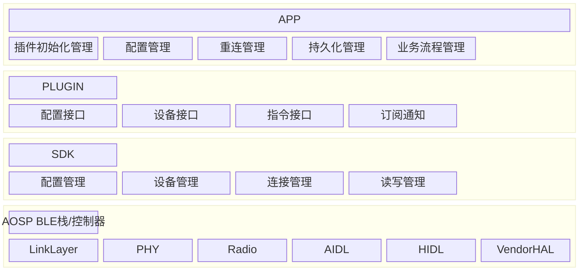
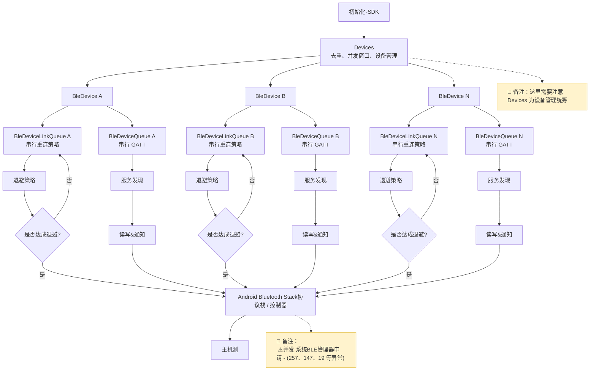
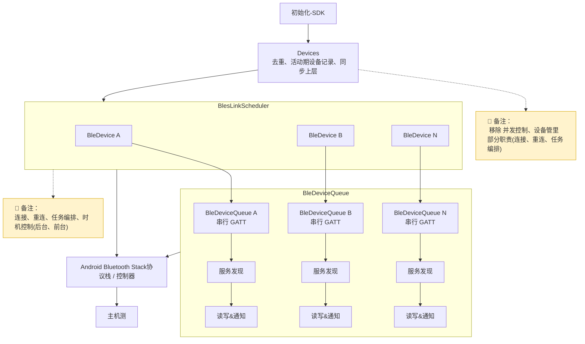

import ImgText from '@site/src/components/ImgText/ImgText'; 
import Tag from '@site/src/components/Tag'; 
import Row from '@site/src/components/Row';
import ChartLine from '@site/src/components/ChartLine';
import ChartBar from '@site/src/components/ChartBar';


# Android BLE多设备连接 优化报告


## 目标 

1. 3秒内设备连接并可用
2. 稳定性(长时间驻留、后台、可用性) - 扩展
3. 耗电量(均衡、暴力) - 扩展


## 现状分析

当前根据 版本 [v 0.9.395](../../yasee_android/download#SDK-最新版本) 为 现有SDK 产物基准. <br/>分析架构、数据统计作为 依据. 

### 架构设计


#### 架构图



BLE 相关架构大致分为 7 层：

```text
Yasee SDK 入口层
    ↓
Ble 蓝牙扫描与蓝牙状态管理层
    ↓
Devices 设备仓库与绑定设备管理层
    ↓
BleDevice 单设备连接与 GATT 通信层
    ↓
BleIoQueue BLE GATT 串行队列层
    ↓
Platforms 平台适配层
    ↓
Decode / Cmd / Notify 数据解析与业务通知层
```


#### SDK BLE流程如下


#### 问题探究👀:

目前 观测 数据得出:
1. 多线程并发 长度无限制
2. 协议栈资源限制 (长时间 未连接后 重试申请次数过于频繁)
3. 重连管理 各设备兼管; 无统筹调度
4. 退避策略; 无间隙、无熔断, (最大影响项), 
  <br/>⚠️ `如: 长时间未连接; 之前为了 省电 做了 指数退避; 最长 60s. 造成 60秒内 不去尝试重连`


### 数据分析

原始数据: [CSV-连接数据](/excel/1113_clear.csv)


---

## 可行性分析 & 优化策略

本次 BLE 连接稳定性与性能指标改造主要围绕 **“多设备尽量 3 秒内 ready、设备重启后尽快重连、可观测可追踪”** 三个目标展开。

### 多设备并发连接 可行

#### Android API 具备多 GATT 设备管理能力

Android `BluetoothManager.getConnectedDevices(BluetoothProfile.GATT)` 返回 GATT Profile 下的已连接设备列表，`getDevicesMatchingConnectionStates(...)` 也返回多个符合状态的设备。这证明 Android API 模型允许同时管理多个 GATT 设备，而非只允许单设备连接。

官方依据：[Android `BluetoothManager`](https://developer.android.com/reference/android/bluetooth/BluetoothManager#getConnectedDevices(int))。

需要限定的是：该 API 证明的是“支持多个”，**不代表官方承诺任意并发数量或特定连接时延**。


#### 每个设备可拥有独立 GATT 会话和异步回调

`BluetoothDevice.connectGatt()` 为目标设备创建 `BluetoothGatt` 客户端，连接结果及后续 GATT 操作由 `BluetoothGattCallback` 异步返回。API 26 的重载允许指定 `Handler`，新 API 还支持显式 `Executor`，因此应用能够隔离不同设备的回调处理与业务状态。

官方依据：

- [连接到 GATT 服务端](https://developer.android.com/develop/connectivity/bluetooth/ble/connect-gatt-server)
- [`BluetoothDevice.connectGatt`](https://developer.android.com/reference/android/bluetooth/BluetoothDevice#connectGatt(android.content.Context,boolean,android.bluetooth.BluetoothGattCallback,int))

线程隔离能减少应用层相互等待，但这里的“回调并行”不等于蓝牙控制器能让全部无线过程同时完成。


#### 项目已有优化证明应用层阻塞值得治理

项目 SDK 历史版本已进行以下优化：

- `0.9.394`：将 GATT 30 秒超时提前至 8 秒处理；
- `0.9.394`：单设备 `IoQueue` 独享线程，多设备线程互不 `delay`；
- `0.9.300`：BLE 重连使用独立线程处理，并规范连接/断开调用线程。

这些记录说明项目过去确实存在多设备共享队列导致互相阻塞的风险，按设备隔离队列有实际价值。

项目依据：[Android SDK 历史版本说明](../../yasee_android/download.md)。


### 本次优化内容如下

#### 1. 多设备连接调度改造

新增/改造了 [BlesLinkScheduler.java](file:///Users/henrygao/Documents/Work/yaseeJava/yasee/src/main/java/com/yasee/yasee/protocols/ble/BlesLinkScheduler.java)。

核心变化：

- 由原来的“所有绑定设备同时 `connectGatt()`”改为调度连接。
- 使用单线程串行调度模型。
- 当前最大并发连接数为：

```java
MAX_CONCURRENT_CONNECT = 3
```

- 单设备 ready 超时时间：

```java
READY_TIMEOUT_MS = 3000
```
```

整体链路变为：

```text
Devices.allAction(true)
↓
BlesLinkScheduler.connectAll(bindDevices)
↓
最多 3 台同时进入连接流程
↓
3 秒未 ready 则释放连接槽
↓
进入重试/重发现策略
```

---

#### 2. 避免多设备同时冲击 Android BLE 栈

修改 [Devices.java](file:///Users/henrygao/Documents/Work/yaseeJava/yasee/src/main/java/com/yasee/yasee/Devices.java)。

原来 `allAction(true)` 会直接对所有绑定设备发起连接，容易导致：

- `status 133`
- connect 超时
- GATT busy
- 服务发现失败
- 多设备互相拖慢

现在改为：

```java
BlesLinkScheduler.single().connectAll(bindDevices());
```

这对多设备稳定性影响很大。

---

#### 3. 断线/超时重连策略优化

[BlesLinkScheduler.java](file:///Users/henrygao/Documents/Work/yaseeJava/yasee/src/main/java/com/yasee/yasee/protocols/ble/BlesLinkScheduler.java) 现在控制：

- 连接槽释放
- ready timeout
- 进入定向扫描

当前策略：

```text
设备断开 / 3 秒未 ready
↓
失败后进入 MAC 定向扫描
↓
扫描命中目标设备广播
↓
立即重新加入连接调度
```

---

#### 4. 设备关机再开机后的重发现机制

修改 [Ble.java](file:///Users/henrygao/Documents/Work/yaseeJava/yasee/src/main/java/com/yasee/yasee/protocols/ble/Ble.java)。

新增/调整了绑定设备重发现扫描：

- `startReconnectScan(Set<String> targetMacs)`
- `stopReconnectScan()`
- `_reconnectScanResult`
- MAC 过滤：
  ```java
  ScanFilter.Builder().setDeviceAddress(mac).build()
  ```
- 扫描模式：
  ```java
  SCAN_MODE_BALANCED
  ```

作用：

```text
设备离线较久
↓
启动 MAC 定向扫描
↓
设备重新开机广播
↓
扫描命中
↓
立即调度连接
```

相比全量扫描，MAC filter + balanced 模式更省电、噪声更低。

---

#### 5. 移除连接前指数退避

用户已在 [BleDevice.java](file:///Users/henrygao/Documents/Work/yaseeJava/yasee/src/main/java/com/yasee/yasee/protocols/ble/BleDevice.java) 中移除：

- `ExponentialBackoff`
- `Thread.sleep(delay)`
- 连接成功后的 `exponentialBackoff.reset()`

这会提升重连响应速度，避免外设重新开机后还因为历史退避而等待几秒甚至十几秒。

---

#### 6. GATT 操作串行化加强

在 [BleDevice.java](file:///Users/henrygao/Documents/Work/yaseeJava/yasee/src/main/java/com/yasee/yasee/protocols/ble/BleDevice.java) 中，多数 GATT 操作已通过 `BleIoQueue` 串行执行，包括：

- `discoverServices`
- `requestMtu`
- `setCharacteristicNotification`
- `writeDescriptor`
- `readCharacteristic`
- `writeCharacteristic`

这样可以减少 Android BLE 栈常见的并发问题：

```text
GATT busy
status 133
callback 乱序
descriptor/write/read 互相抢占
```

---

#### 7. 旧 GATT callback 防污染

在 [BleDevice.java](file:///Users/henrygao/Documents/Work/yaseeJava/yasee/src/main/java/com/yasee/yasee/protocols/ble/BleDevice.java) 的主要 callback 中加入：

```java
if (gatt != _gatt) return;
```

覆盖路径包括：

- `onConnectionStateChange`
- `onServicesDiscovered`
- `onCharacteristicRead`
- `onCharacteristicWrite`
- `onDescriptorWrite`
- `onCharacteristicChanged`
- `onReadRemoteRssi`
- `onMtuChanged`

作用：

```text
旧连接 callback 晚到
↓
不会污染新连接队列/状态
```

对频繁断开/重连尤其重要。

---

#### 8. 服务发现失败和 descriptor 写失败立即重连

在 [BleDevice.java](file:///Users/henrygao/Documents/Work/yaseeJava/yasee/src/main/java/com/yasee/yasee/protocols/ble/BleDevice.java) 中加强失败路径：

#### 服务发现失败

现在会立即：

- 记录失败
- bump queue generation
- `setState(0)`
- `refreshDeviceCache()`
- 调度重连

不再单纯等待 3 秒 ready timeout。

#### descriptor 写失败

现在也会立即：

- 记录失败
- bump queue generation
- `setState(0)`
- `refreshDeviceCache()`
- 调度重连

这能更快释放连接槽，避免坏连接占用多设备调度资源。

---


#### 9. 新增独立性能指标工具类

新增 [PerformanceTool.java](file:///Users/henrygao/Documents/Work/yaseeJava/yasee/src/main/java/com/yasee/yasee/core/tools/PerformanceTool.java)。

职责：

- 记录 BLE 关键事件
- 记录开始时间、结束时间、耗时
- 维护设备维度关键时间点
- 通过 [FileTool.java](file:///Users/henrygao/Documents/Work/yaseeJava/yasee/src/main/java/com/yasee/yasee/core/tools/FileTool.java) 输出 CSV

输出文件：

```text
cacheDir/ble_performance_metrics.csv
```

CSV 字段：

```csv
timestamp,mac,model,eventName,startTime,endTime,durationMs,bleScanFoundTime,addedBindDeviceTime,connectStartTime,connectSuccessTime,serviceDiscoveredTime,notifySubscribedTime,statusCode,extra
```

当前已接入事件：

- BLE 扫描发现
- 添加绑定设备
- 开始连接
- 连接成功
- 服务发现开始
- 服务发现完成
- notify 订阅开始
- notify 订阅成功/失败
- ready
- 连接失败
- ready timeout


---


## 优化后


### 架构设计

架构设计未变更; SDK 负责的内容和职责无增减 


#### 优化后 SDK BLE流程如下



### 数据分析

原始数据: [CSV-连接日志-13号](/excel/1113_clear.csv)

原始数据: [CSV-连接日志-14号](/excel/1114_ble_performance_metrics.csv)


---


## 前 VS. 后

---  


### 架构 VS.

主要做减法 和 职责拆分:

#### 新增
1. <Tag text={"新增"} /> `BlesLinkScheduler` 调度管理; 负责 连接、重连、任务编排、时机控制(后台、前台)
2. <Tag text={"新增"} /> 前后台应用识别; 控制 调度 逻辑; 后台停止一切重连、任务执行; 保持已连接的 IO.
3. <Tag text={"新增"} /> IO Queue 增加 read 入列; 
4. <Tag text={"新增"} /> 连接过程中; 因服务 和 特征 设置导致的重连后置; 
5. <Tag text={"新增"} /> 最大并发连接数(3)、 超时设置(3)


#### 移除
1. <Tag text={"移除"} color="red" /> `linkQueue` 控制连接独立线程
2. <Tag text={"移除"} color="red" /> 指数退避; 度绝 历史退避等待几秒甚至几十秒才连接的情况
3. <Tag text={"移除"} color="red" /> 频繁 申请设备连接

### 数据 VS.

*遵循如下一致性信息:*
1. 同机型 (红米 Pad)
2. 同时间; > 8h | 短时
3. 同设备: D1、D6、D8、M9


#### 长时间持续连接情况

*频繁重连 次数统计(>8h)*
<ChartBar
  data={[
    { 
      label: '连接', 
      measurements: [
        {name: "新",value: 20,color: 'green'},
        {name: "老",value: 335, color: 'red' },
      ] 
    },
  ]}
/>


*GATT错误统计*
<ChartBar
  data={[
    { 
      label: '主机(8、19、62)', 
      measurements: [
        {name: "新",value: 18,color: 'green'},
        {name: "老",value: 15, color: 'red' },
      ] 
    },
    { 
      label: '栈超时(147)', 
      measurements: [
        {name: "新",value: 0,color: 'green'},
        {name: "老",value: 43, color: 'red' },
      ] 
    },
    { 
      label: '栈未知(255)', 
      measurements: [
        {name: "新",value: 0,color: 'green'},
        {name: "老",value: 19, color: 'red' },
      ] 
    },
    { 
      label: '栈超限(257)', 
      measurements: [
        {name: "新",value: 0,color: 'green'},
        {name: "老",value: 89, color: 'red' },
      ] 
    },
    { 
      label: 'SDK3秒超时(-3000)', 
      measurements: [
        {name: "新",value: 1,color: 'green'},
        {name: "老",value: 6, color: 'red' },
      ] 
    },
  ]}
/>


#### 短时间连接情况

*连接速度 情况(avg)*

平均 时间减少 **800ms** 左右
<ChartBar datas={[
{name: "新",value: 1.91,color: 'green'},
{name: "老",value: 2.75, color: 'red' },
]} />

*各个设备情况*
<ChartBar
  data={[
    { 
      label: 'D1', 
      measurements: [
        {name: "新",value: 0,color: 'green'},
        {name: "老",value: 1.85, color: 'red' },
      ] 
    },
    { 
      label: 'D6', 
      measurements: [
        {name: "新",value: 2.13,color: 'green'},
        {name: "老",value: 0, color: 'red' },
      ] 
    },
    { 
      label: 'D8', 
      measurements: [
        {name: "新",value: 2.34,color: 'green'},
        {name: "老",value: 2.75, color: 'red' },
      ] 
    },
  ]}
/>

*连接时长占比*
两台D1; 每台60次测试.
老SDK `> 3` 的占比约为 33%; 
新SDK `> 3` 的占比约为 33%; 
<ChartBar
  data={[
    { 
      label: '< 3s', 
      measurements: [
        {name: "新",value: 0,color: 'green'},
        {name: "老",value: 80, color: 'red' },
      ] 
    },
    { 
      label: '3 ~ 10s', 
      measurements: [
        {name: "新",value: 0,color: 'green'},
        {name: "老",value: 37, color: 'red' },
      ] 
    },
    { 
      label: '> 10s', 
      measurements: [
        {name: "新",value: 0,color: 'green'},
        {name: "老",value: 3, color: 'red' },
      ] 
    },
  ]}
/>


## 总结


### 摘要

> **裁定：Android 支持同时维护多个 BLE GATT 连接，因此多设备并发连接在能力层面没有问题; 但 Android 与 Bluetooth 官方规范均未承诺扫描、连接、服务发现和业务初始化可在 3 秒内完成。**
>
> 因此，“3 秒”应定义为指定设备数、手机型号、外设状态和射频环境下的性能 **SLO（服务等级目标）**，不能定义为跨机型、跨设备的硬性 **SLA（服务等级协议）**。优化 可以消除 SDK 内部队列互相阻塞，但不能突破系统蓝牙栈、控制器、广播周期、射频环境或外设响应速度的限制。

优化的目标 以 **单设备内 GATT 操作串行、多设备会话并行、全局连接窗口限流** 为原则，并通过 测试数据 3 秒达标率和错误码分布验证目标。


### 时间统计标准

统一口径，“连接耗时”将无法比较。建议记录以下时间点：

| 时间点 | 含义 |
| --- | --- |
| `ble_scan_found` | 首次扫描到目标设备；已知且可直连时可为空 |
| `connect_start` | 开始连接时间 |
| `connect_success` | GATT 握手成功 |
| `service_discover_start` | 开始服务发现 |
| `service_discovered` | 发现完成 |
| `notify_subscribe_start` | 开始订阅 |
| `notify_subscribed` | 订阅完成 |
| `ready` | 整体完成 |

当前验证标准 默认以 **`ready <= 3 秒`** 作为“3 秒业务就绪”的完整目标。


### 针对连接速度&稳定性的影响排名

下面按“对多设备 3 秒 ready、连接稳定性、重连速度”的综合影响排序。

---

#### 第 1 名：多设备连接调度器 BlesLinkScheduler

影响最大。

原因：

- 避免所有绑定设备同时 `connectGatt()`。
- 限制并发，降低 Android BLE 栈压力。
- 3 秒未 ready 自动释放槽位。
- 失败设备不会拖慢其他设备。

影响范围：

```text
多设备连接速度
多设备稳定性
status 133 概率
连接槽释放效率
整体 3 秒 ready 成功率
```

这是最核心的架构优化。

---

#### 第 2 名：GATT 操作串行化 + 旧 callback 防污染

影响非常大。

原因：

BLE GATT 操作天然需要串行。现在大部分 GATT 操作进入 `BleIoQueue`，并且 callback 增加：

```java
if (gatt != _gatt) return;
```

可以明显减少：

- 旧连接 callback 污染新连接
- GATT busy
- descriptor/write/read 乱序
- 断开重连后的状态错乱

影响范围：

```text
ready 成功率
notify 订阅成功率
数据收发稳定性
重连后的可靠性
```

---

#### 第 3 名：移除连接前指数退避

影响主要体现在重连速度。

原因：

之前外设关机较久后，退避可能增长到：

```text
300ms → 600ms → 1200ms → 2400ms → 4800ms → 9600ms → 15000ms
```

设备重新开机时，手机可能仍在等待退避 sleep。

移除后：

```text
调度器到点
↓
立即 connectGatt
```

影响范围：

```text
设备重启后重连速度
前台连接响应速度
直连重试效率
```

---

#### 第 4 名：服务发现/descriptor 失败立即释放并重连

影响很实际。

原因：

原来失败后可能等 3 秒 ready timeout 才释放连接槽。现在失败点能立即：

```text
记录失败
断开/close
释放状态
调度重连
```

影响范围：

```text
失败恢复速度
多设备连接槽利用率
异常设备不阻塞其他设备
```

---

# 最终排序表

| 排名 | 优化项 | 对连接&稳定性提升影响 |
|---:|---|---|
| 1 | [BlesLinkScheduler](file:///Users/henrygao/Documents/Work/yaseeJava/yasee/src/main/java/com/yasee/yasee/protocols/ble/BlesLinkScheduler.java) 多设备调度 | 较大，直接提升多设备稳定性 |
| 2 | GATT 串行化 + 旧 callback 防污染 | 中等; 提升 ready 和数据通道稳定性 |
| 3 | 移除连接前指数退避 | 较大，提升重连响应速度 |
| 4 | 服务发现/descriptor 失败立即重连 | 较大,减少无效等待 |


### 承诺所有设备 3 秒内就绪的难点

#### 连接流程是多阶段异步链路

`connectGatt()` 的连接结果通过回调异步返回；连接后仍需调用异步的 `discoverServices()`，随后通常还要启用通知、写入 CCCD，并执行厂商协议握手。`onConnectionStateChange(STATE_CONNECTED)` 只代表 GATT 连接状态变化，不代表服务发现和业务初始化已经完成。

官方依据：

- [`BluetoothGatt.discoverServices()`](https://developer.android.com/reference/android/bluetooth/BluetoothGatt#discoverServices())：明确说明服务发现为异步操作，完成后触发 `onServicesDiscovered`；
- [`BluetoothGattCallback`](https://developer.android.com/reference/android/bluetooth/BluetoothGattCallback#onConnectionStateChange(android.bluetooth.BluetoothGatt,int,int))：连接状态、服务发现、描述符写入均为不同回调。

**结论：**只测到 `Tconnected` 会低估真实可用时间，`Tready` 可正常保证设备可用情况; 但时间无法保证。


#### 系统栈和控制器是共享资源，存在拥塞与超时

Android 定义了 `GATT_CONNECTION_CONGESTED`，明确表示远端设备连接可能拥塞；也定义了 `GATT_CONNECTION_TIMEOUT`，说明设备超出范围或未作为可连接设备广播时可能超时。应用创建更多线程不会增加手机蓝牙控制器、射频时隙或系统 GATT 栈容量。

官方依据：[`BluetoothGatt` 状态码](https://developer.android.com/reference/android/bluetooth/BluetoothGatt)。

**结论：**多线程只能处理 CPU 侧工作，不能把系统与无线链路变成无限并行。过度同时发起连接反而可能 **放大拥塞**，应通过连接窗口限流。


#### 协议参数存在较大合法范围

Android `onConnectionUpdated` 文档给出的连接间隔合法范围为 7.5 ms～4000 ms，监督超时范围为 0.1 s～32 s。`requestConnectionPriority(HIGH)` 只是请求低延迟连接参数，官方建议仅在快速传输大量数据时使用，并在完成后恢复 `BALANCED`；`setPreferredPhy()` 也只是建议，实际是否切换取决于双方能力，控制器可覆盖设置。

官方依据：

- [`BluetoothGattCallback.onConnectionUpdated`](https://developer.android.com/reference/android/bluetooth/BluetoothGattCallback#onConnectionUpdated(android.bluetooth.BluetoothGatt,int,int,int,int))
- [`BluetoothGatt.requestConnectionPriority`](https://developer.android.com/reference/android/bluetooth/BluetoothGatt#requestConnectionPriority(int))
- [`BluetoothGatt.setPreferredPhy`](https://developer.android.com/reference/android/bluetooth/BluetoothGatt#setPreferredPhy(int,int,int))

**结论：**官方 API 没有给出 3 秒完成上界，“高优先级”与“首选 PHY”也不能作为 3 秒保证手段。


#### Android 硬件与厂商实现存在差异

AOSP 明确指出 BLE 使用依赖设备芯片支持，扫描过滤等能力也与控制器/固件实现相关。不同 SoC、Android 版本、厂商蓝牙栈和功耗策略会造成连接数量、调度及后台表现差异；外设自身还可能限制可同时连接的 central 数量。

官方依据：[AOSP：Bluetooth Low Energy](https://source.android.com/docs/core/connect/bluetooth/ble)。Bluetooth 技术与互操作性的规范入口见 [Bluetooth SIG Core Specification 6.1](https://www.bluetooth.com/specifications/specs/core-specification-6-1/)，该入口同样未给出适用于所有 Android 与外设组合的“3 秒业务就绪”承诺。

**结论：** 单一手机、单一外设的一次成功不能证明跨机型 SLA；必须使用机型和外设矩阵做统计验证。


#### 参考资料
- [SIG错误码](https://www.bluetooth.com/wp-content/uploads/Files/Specification/HTML/Core_v7.0/out/en/architecture%2C-change-history%2C-and-conventions/controller-error-codes.html)
- [AOSP错误](https://developer.android.com/reference/android/bluetooth/BluetoothGatt)
- [Android：查找 BLE 设备](https://developer.android.com/develop/connectivity/bluetooth/ble/find-ble-devices)
- [AOSP：Bluetooth Low Energy](https://source.android.com/docs/core/connect/bluetooth/ble)
- [Android：关闭 GATT 连接](https://developer.android.com/develop/connectivity/bluetooth/ble/connect-gatt-server#close-gatt)
- [`BluetoothGatt.close()`](https://developer.android.com/reference/android/bluetooth/BluetoothGatt#close())

- Android Developers：[Connect to a GATT server](https://developer.android.com/develop/connectivity/bluetooth/ble/connect-gatt-server)
- Android Developers：[Find BLE devices](https://developer.android.com/develop/connectivity/bluetooth/ble/find-ble-devices)
- Android API：[`BluetoothDevice.connectGatt`](https://developer.android.com/reference/android/bluetooth/BluetoothDevice#connectGatt(android.content.Context,boolean,android.bluetooth.BluetoothGattCallback,int))
- Android API：[`BluetoothGatt`](https://developer.android.com/reference/android/bluetooth/BluetoothGatt)
- Android API：[`BluetoothGattCallback`](https://developer.android.com/reference/android/bluetooth/BluetoothGattCallback)
- Android API：[`BluetoothManager`](https://developer.android.com/reference/android/bluetooth/BluetoothManager)
- AOSP：[Bluetooth Low Energy](https://source.android.com/docs/core/connect/bluetooth/ble)
- Bluetooth SIG：[Core Specification 6.1](https://www.bluetooth.com/specifications/specs/core-specification-6-1/)
