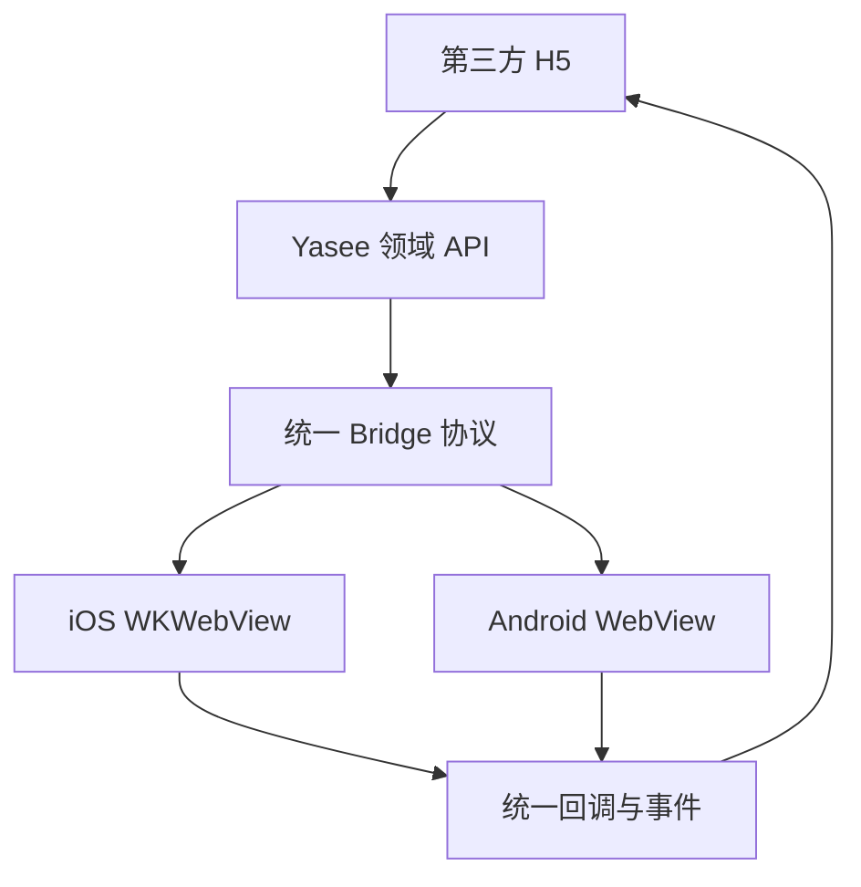

# Yasee JS SDK 分析

## 1. 背景

百合医平台需要承载第三方 H5 服务。H5 运行在 App WebView 中时，单靠浏览器标准能力无法直接完成以下操作：

- 获取 App 和设备信息；
- 获取当前用户授权信息；
- 调起 Native 支付、扫码、图片选择和分享；
- 控制 Native 页面标题、返回行为和底部导航；
- 修改 WebView 容器样式；
- 接收 App 主动推送的页面或业务事件。

如果每个 H5 项目分别与 iOS、Android 约定调用方式，会产生重复接入、协议不一致、错误处理分散和升级困难等问题。

Yasee JS SDK 的作用，是在第三方 H5 和百合医 App Native 能力之间建立统一、稳定、可测试的通信层。



## 2. SDK 的核心意义

### 2.1 屏蔽端能力差异

H5 只需要调用统一接口：

```js
await yasee.media.imgChoose({ count: 1 });
```

SDK 会根据运行环境选择不同的 Native 通道：

- iOS：`window.webkit.messageHandlers.YaseeSDK.postMessage(...)`
- Android：`window.YaseeSDK.postMessage(...)`

业务代码不需要识别平台，也不需要分别维护 iOS 和 Android 调用逻辑。

### 2.2 建立统一的 Native 协议

所有 H5 → Native 调用统一为：

```ts
{
  callbackId,
  module,
  method,
  params
}
```

统一协议带来的价值：

- Native 可以使用一个入口分发所有能力；
- 每个调用通过 `callbackId` 精确关联异步结果；
- 新增能力时不需要重新设计通信机制；
- 协议日志、问题排查和自动化测试更容易标准化。

### 2.3 将底层通信转换为业务 API

SDK 不要求 H5 直接拼接 `module`、`method` 和参数，而是按业务领域提供接口：

```text
yasee.app.*
yasee.ui.*
yasee.navigation.*
yasee.user.*
yasee.media.*
yasee.share.*
yasee.scan.*
```

这使调用方关注“要完成什么业务动作”，而不是“如何向 Native 发消息”。

### 2.4 形成平台能力边界

SDK 是百合医 App 对第三方 H5 开放能力的统一出口。

通过 `support()`，H5 可以在调用前检查能力：

```js
if (yasee.support("scan.qrCode")) {
  await yasee.scan.qrCode();
}
```

这为未来处理 App 版本差异、能力灰度和兼容策略提供了标准入口。

## 3. 当前已经提升的能力

### 3.1 业务能力提升

当前 SDK 已经将以下 Native 能力开放给 H5：

| 领域 | 能力 | 价值 |
|---|---|---|
| App | 获取 App/设备信息 | 支持环境识别、版本判断和问题定位 |
| App | 系统浏览器打开 URL | 处理需要跳出 WebView 的外部链接 |
| App | 支付宝、微信支付 | H5 可以复用 App 原生支付能力 |
| UI | Toast、Loading | 保持 H5 与 App 一致的交互体验 |
| UI | 修改 Web 容器背景色 | 支持页面与 Native 容器视觉融合 |
| Navigation | 标题、返回、页面跳转 | 统一管理 H5 和 Native 页面栈 |
| Navigation | 底部 Tabs 显隐 | 满足沉浸式或独立业务页面需求 |
| User | 获取授权信息 | H5 可接入 App 登录态和身份体系 |
| User | 更新用户、退出登录 | 支持用户状态与 App 同步 |
| Media | 选择和下载图片 | 复用系统相册、权限和文件能力 |
| Share | 微信 Web 分享 | 复用 App 原生分享渠道 |
| Scan | 二维码扫描 | H5 获得系统摄像头和扫码能力 |

### 3.2 开发效率提升

接入方不再需要：

- 分别编写 iOS、Android 判断；
- 手工生成和维护 callback ID；
- 自己管理 Native 回调与 Promise 的关联；
- 为每个项目重复设计事件监听机制；
- 直接操作容易拼错的全局 Bridge 对象。

一个典型调用可简化为：

```js
try {
  const response = await yasee.scan.qrCode();
  console.log(response.data);
} catch (error) {
  console.error(error.code, error.message);
}
```

### 3.3 稳定性提升

SDK 为调用链增加了统一保障：

- 普通调用默认具有超时机制，避免 Promise 永久等待；
- 超时后自动清理回调记录，降低长期运行 WebView 的内存泄漏风险；
- Native 成功回调后自动清理计时器；
- Native Bridge 不存在时返回明确错误，而不是静默失败；
- 用户交互型接口允许不设置超时，避免用户选择图片、支付或扫码时被提前中断；
- 事件处理器异常会被隔离，不会阻断其他订阅者。

统一错误语义：

| code | 含义 |
|---|---|
| `0` | Native 调用成功 |
| `-1` | 调用超时 |
| `-2` | Native Bridge 不可用 |
| 其他 | Native 返回的业务错误 |

### 3.4 类型安全提升

SDK 使用 TypeScript 声明公开参数，例如：

```ts
yasee.media.imgDownload({
  url: "https://example.com/image.png",
});
```

必填参数会在开发阶段得到校验，能够减少参数缺失、方法拼写和数据结构错误。

构建过程同时生成 `dist/index.d.ts`，使用 TypeScript 的 H5 项目可以获得自动补全和类型提示。

### 3.5 可测试性提升

项目已经建立三层测试能力：

#### 自动化测试

当前自动化测试覆盖：

- Native 成功回调；
- 调用超时及单次超时；
- Bridge 不可用；
- 浏览器 Mock；
- Native 主动事件；
- ready 状态；
- 业务 API 的 `module/method/params` 协议；
- `support()` 能力列表。

#### 浏览器 Mock

在没有 App 的情况下，可以显式启用：

```js
yasee.config({ mock: true });
```

这使 H5 开发者可以先完成页面流程和 SDK 接入，再进入 App 联调。

#### 全量 Demo

`demo/` 提供全量 API 测试页面：

- 每个接口可以单独调用；
- 支持修改测试参数；
- 支持一键运行全部接口；
- 底部浮动日志面板展示请求、响应和错误；
- 日志面板支持最小化和半屏放大；
- 可以模拟 Native 主动事件。

这不仅是演示页面，也可以作为 H5、iOS、Android 三方联调时的协议验收工具。

### 3.6 发布与交付能力提升

SDK 已支持：

- IIFE 浏览器构建：适合通过 `<script>` 引入；
- ESM 构建：适合现代前端工程；
- TypeScript 声明文件；
- 发布前自动类型检查、测试和构建；
- npm 发布文件白名单；
- 明确的包入口和 `exports` 配置。

发布前执行：

```bash
npm run prepack
```

可以降低类型错误、测试失败或陈旧构建产物进入发布包的风险。

## 4. 对不同角色的价值

### 对第三方 H5 开发者

- 只学习一套 JavaScript API；
- 不需要理解 iOS、Android Bridge 细节；
- 获得类型提示、Promise 调用和统一错误处理；
- 可以脱离 App 使用 Mock 开发；
- 接入和联调成本更低。

### 对 iOS / Android 开发者

- 只维护统一消息入口和回调协议；
- 各业务能力具有明确的 `module/method`；
- Demo 可作为协议联调基线；
- 减少不同 H5 项目重复定义 Bridge 的情况。

### 对平台维护者

- App 开放能力具备统一目录和边界；
- 新增能力可以按模块持续扩展；
- 能力调用更容易统计、监控和审计；
- SDK 可以独立版本化、测试和发布；
- 第三方接入质量不再完全依赖口头协议。

### 对用户体验

- H5 与 Native 使用一致的 Toast、Loading、导航和分享能力；
- 登录、支付、扫码等流程无需跳出 App 生态；
- H5 页面能够更自然地融入 Native 页面栈和视觉体系；
- 减少因平台差异导致的功能失效和交互割裂。

## 5. 引入 SDK 前后的对比

| 维度 | 无统一 SDK | 使用 Yasee JS SDK |
|---|---|---|
| 平台适配 | H5 分别处理 iOS、Android | SDK 内部统一适配 |
| API 设计 | 各项目自行约定 | 按业务领域统一命名 |
| 异步回调 | 手工维护全局回调 | Promise + callbackId 自动关联 |
| 错误处理 | 各项目自行实现 | 统一响应和错误码 |
| 超时与清理 | 容易遗漏 | SDK 集中处理 |
| Native 事件 | 临时全局函数 | 统一订阅和取消订阅 |
| 本地开发 | 强依赖 App 联调 | 支持显式 Mock |
| 类型提示 | 通常没有 | TypeScript 声明 |
| 协议验证 | 依赖人工沟通 | 自动化测试 + 全量 Demo |
| 发布质量 | 手工构建 | 发布前自动检查 |

## 6. 后续可继续提升的方向

### 6.1 Native 能力版本协商

当前 `support()` 使用 SDK 内置清单。后续可以由 Native 返回实际能力和版本：

```ts
await yasee.app.getCapabilities();
```

从而支持不同 App 版本、平台和灰度环境的动态能力判断。

### 6.2 更精确的响应类型

为每个接口补充响应类型，例如：

```ts
interface ScanResult {
  content: string;
  format: string;
}
```

使调用方不仅知道参数结构，也能获得返回值自动补全。

### 6.3 可观测性

可以在 Bridge 层统一增加：

- 调用耗时；
- 成功率和错误码；
- 超时率；
- App、SDK 和 H5 版本；
- `module/method` 维度的调用统计。

这能将跨端问题从“无法复现”转变为可定位、可量化的问题。

### 6.4 安全控制

随着开放能力增加，可进一步引入：

- H5 域名白名单；
- API 权限和授权范围；
- 请求签名或会话校验；
- 敏感参数脱敏；
- 高风险能力二次确认。

### 6.5 协议文档自动生成

可以从 TypeScript 类型和 API 定义生成：

- H5 接入文档；
- Native 协议清单；
- 示例代码；
- `support()` 能力列表；
- Demo 测试项。

这样可以进一步减少实现、文档和测试之间的不一致。

## 7. 总结

Yasee JS SDK 并不只是对 `postMessage` 的简单封装，它承担的是百合医 App 向第三方 H5 开放平台能力的标准层。

它当前带来的主要提升可以概括为：

1. **统一能力出口**：以领域 API 管理 App 开放能力；
2. **统一跨端协议**：屏蔽 iOS、Android 通信差异；
3. **提升研发效率**：减少重复接入和底层 Bridge 代码；
4. **提升稳定性**：集中处理回调、超时、清理和错误；
5. **提升可测试性**：支持 Mock、自动化测试和全量联调 Demo；
6. **提升交付质量**：具备类型声明、构建产物和发布门禁；
7. **改善用户体验**：让 H5 更完整地融入 App 的账号、支付、导航和交互体系。

随着能力版本协商、监控、安全和类型体系继续完善，该 SDK 可以进一步演进为百合医 Hybrid 生态的标准能力平台。
